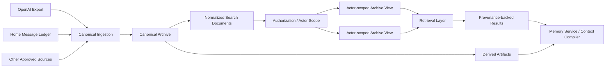

# Unified AI Memory & Archive

> A provenance-aware, actor-scoped evidence and retrieval architecture for persistent AI systems.

**Status:** Production-backed architecture · Public case study  
**Focus:** provenance · permissions · source-of-truth design · retrieval · SQLite / FTS · AI memory systems

---

## Why This Exists

Long-running AI systems need more than a growing chat transcript.

They need a way to answer questions such as:

- What is the canonical source?
- Which actor is allowed to retrieve it?
- Which records are raw evidence versus derived artifacts?
- How do we preserve provenance through retrieval?
- How do we prevent semantic similarity from bypassing permissions?
- How can summaries and indexes be rebuilt without destroying source data?

This project documents the archive and retrieval layer behind a persistent multi-agent AI workspace.

It is published as a **sanitized case study**. Private conversations, personal memory, secrets and production configuration are intentionally excluded.

---

## Core Principle

> **Evidence first. Derivations are rebuildable. Permissions are checked before retrieval.**

The archive separates:

1. **Canonical source records** — immutable or append-only evidence.
2. **Normalized records** — source-neutral representations used for indexing and retrieval.
3. **Actor-scoped views** — filtered projections that enforce who can see what.
4. **Derived artifacts** — summaries, indexes and working-memory outputs that can be regenerated.

---

## Architecture



The archive itself is not the model prompt and is not equivalent to "memory."

It is the durable evidence layer that memory and context systems can safely retrieve from.

---

## What Is Working

| Capability | Status |
|---|---|
| Canonical ingestion from historical AI exports | ✅ Working |
| Canonical ingestion from Home message history | ✅ Working |
| Source-neutral normalized records | ✅ Working |
| Provenance preservation | ✅ Working |
| Actor-scoped archive views | ✅ Working |
| Searchable SQLite / FTS projections | ✅ Working |
| Permission-negative validation | ✅ Working |
| Fail-closed retrieval behavior | ✅ Working |
| Explicit archive access from runtime | ✅ Working |
| Automatic memory recall into answers | 🟡 Not enabled here |
| Retrieval-driven production context injection | 🟡 Staged separately |

This repo focuses on the **evidence and authorization layer**, not on presenting automatic recall as production-complete.

---

## Key Design Decisions

### Authorization before semantic retrieval

Similarity is not permission.

Actor scope, ACL and visibility rules are applied before content becomes eligible for retrieval.

### Raw evidence remains canonical

Summaries, search indexes and memory cards do not replace source records.

If a derived artifact becomes stale or incorrect, it should be possible to rebuild it.

### Provenance survives normalization

A retrieved result should retain enough source information to answer:

- where it came from
- which source record produced it
- what transformation occurred
- whether it is raw evidence or a derived artifact

### Actor identity is stable

Access is based on stable logical actor identity, not whichever UI, session, model or endpoint happens to be active.

### Fail closed

If an actor-scoped view or authorization check is unavailable, the system should not fall back to unrestricted data.

More detail: [Design Decisions](docs/DESIGN_DECISIONS.md)

---

## Example Retrieval Flow

```text
Query
→ trusted actor identity
→ hard permission filters
→ actor-scoped candidate set
→ structured / FTS retrieval
→ ranking
→ provenance-backed result
→ bounded context pack
```

This is intentionally different from:

```text
query → vector similarity → whatever looks relevant
```

---

## Example Data

- [Canonical Archive Record](examples/archive-record.example.json)
- [Provenance-backed Retrieval Result](examples/retrieval-result.example.json)

The examples are synthetic and contain no private conversation data.

---

## Reliability & Validation

Validation includes:

- permission-negative tests
- denied-source checks
- actor-scope verification
- provenance checks
- rebuildable projection tests
- source / derived-state separation
- fail-closed behavior
- controlled runtime access

The goal is not only to return relevant content, but to return **authorized, attributable evidence**.

---

## My Role

I drive:

- archive and retrieval problem framing
- canonical / derived data boundaries
- actor-scope and permission requirements
- provenance requirements
- architecture decisions
- acceptance criteria
- negative testing
- migration and rollout decisions
- production validation
- public portfolio documentation

I use AI extensively as an implementation partner for coding, review and iteration.

---

## Technologies & Concepts

**Data / Search**  
SQLite · FTS · JSON · normalized records · source-neutral schemas

**AI Systems**  
retrieval · context engineering · memory systems · provenance · structured outputs

**Engineering**  
ACL · actor-scoped views · fail-closed design · regression testing · migration safety · rebuildable projections

---

## Relationship to Home

This project is a supporting case study for:

[Home — Persistent Multi-Agent AI Workspace](https://github.com/echowang519/home-ai-workspace)

Home shows the end-to-end product and runtime.  
This repository isolates the **evidence, provenance and authorization architecture** behind long-running memory and retrieval.

---

## What This Demonstrates

This project demonstrates the ability to think beyond "give the model more context."

It focuses on:

- evidence architecture
- source-of-truth design
- permission-aware retrieval
- provenance
- safe derived state
- persistent AI memory foundations

These are core concerns for reliable AI systems that operate across long time horizons and multiple actors.
